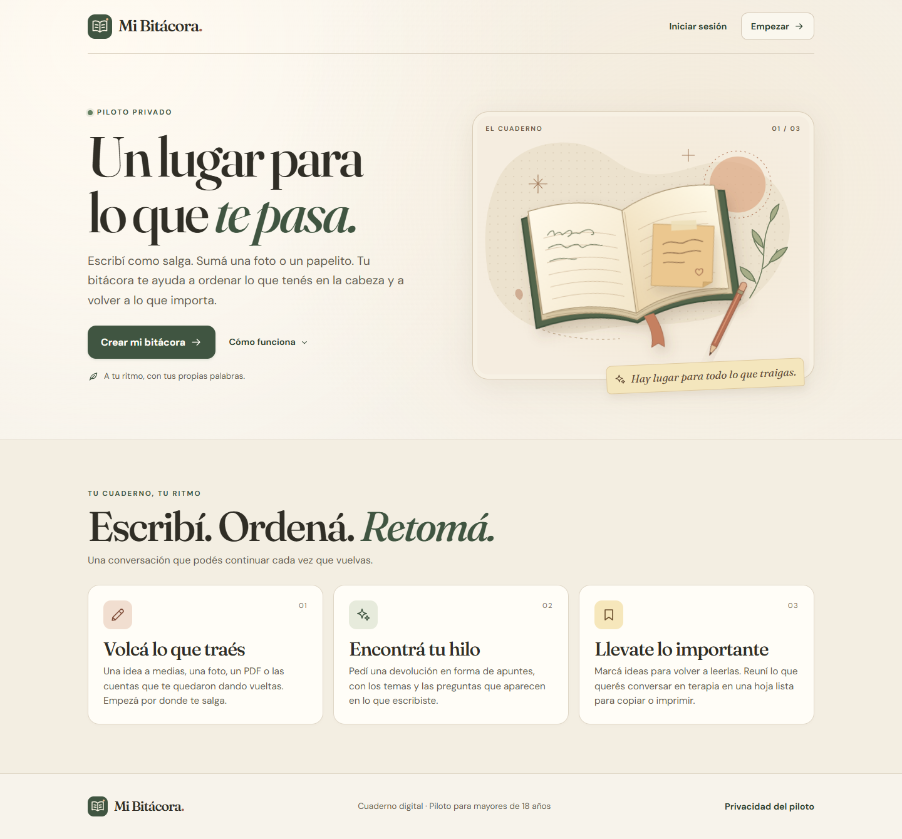

# Mi Bitácora

Piloto local de un cuaderno conversacional para escribir, ordenar ideas y preparar una hoja para retomar temas. Usa Blazor Web App con interactividad en el servidor, ASP.NET Core Identity, .NET 10 y SQLite.



## Abrir el piloto

Con el SDK de .NET 10 instalado, abrí PowerShell y ejecutá:

```powershell
Set-Location 'C:\Dev\MiBitacora'
dotnet run --launch-profile http
```

Abrí [localhost:5234](http://localhost:5234), elegí **Crear mi bitácora** y registrá una cuenta. La base se crea en `App_Data/mi-bitacora.db` en el primer arranque. Podés abrir [la solución](MiBitacora.sln) en Visual Studio y ejecutar el perfil **http**.

Para una primera vuelta, en **Conversación** tocá **Probar con un ejemplo** y después **Ordenar mis ideas**. La devolución usa Ollama y Qwen3-VL 4B instalados en el mismo equipo. También podés guardar entradas sin pedir una devolución. Si Ollama está detenido, la entrada queda guardada y se muestra una opción para reintentar.

## IA local en Windows

1. Instalá [Ollama para Windows](https://ollama.com/download/windows) si todavía no lo tenés. Qwen3-VL requiere Ollama 0.12.7 o posterior; en el piloto se verificó 0.40.15.
2. En los ajustes de la app de Ollama, desactivá **Expose Ollama to the network**. Fijá el contexto en 8192 si aparece esa opción: la app puede sobrescribir las variables de entorno con sus preferencias.
3. Con Ollama sin consultas activas, ejecutá:

   ```powershell
   Set-Location 'C:\Dev\MiBitacora'
   .\scripts\Configure-LocalOllama.ps1 -DownloadModel
   dotnet run --launch-profile http
   ```

El script configura Ollama para el usuario actual: escucha exclusivamente en `127.0.0.1:11434`, desactiva funciones cloud, habilita Vulkan y la GPU integrada y limita la carga a un modelo y una generación simultánea. Reinicia Ollama y conserva la ubicación de sus modelos. Si hay un modelo cargado, primero terminá las consultas y liberalo con `ollama stop <modelo>`. Guarda los valores anteriores en `%LOCALAPPDATA%\MiBitacora\ollama`.

La descarga inicial de `qwen3-vl:4b-instruct` ocupa aproximadamente 3,3 GB y requiere Internet. Las devoluciones posteriores usan el modelo instalado. Las actualizaciones de Ollama y las descargas son operaciones distintas de la inferencia; `OLLAMA_NO_CLOUD=1` no equivale a un firewall que bloquee toda salida.

La configuración del proyecto está en `appsettings.json`, sección `Ollama`. La conexión es de servidor a servidor, con proxy y redirecciones HTTP deshabilitados. Se rechazan URLs fuera de loopback y modelos distintos de `qwen3-vl:4b-instruct`. No existe fallback a un proveedor externo. Las claves de Gemini de instalaciones anteriores ya no se utilizan.

Para verificar texto, imágenes sintéticas, errores, cancelación y separación entre cuentas:

```powershell
dotnet run --project tests\MiBitacora.Checks
dotnet run --project tests\MiBitacora.Checks -- --live
ollama ps
```

`--live` ejecuta dos devoluciones reales con datos inventados. El resto de las comprobaciones usa respuestas simuladas y una base temporal. Más detalles en [la guía de IA local](docs/ia-local.md).

## Qué podés probar

- **Conversación.** Un hilo por cuenta con tus originales y las devoluciones por separado. Para cada devolución se recuperan antecedentes recientes o relacionados, notitas y el contexto personal o cultural que hayas escrito en tu perfil.
- **Adjuntos.** El selector nativo abre archivos y fotos. En el teléfono, **Foto** solicita la cámara cuando el navegador admite la captura nativa. La extracción local cubre documentos de Word modernos, Excel, CSV, texto y otros formatos de oficina. La IA local analiza JPEG, PNG y WebP, hasta dos imágenes por devolución. PDF, HEIC/HEIF, GIF, AVIF y audio se conservan como adjuntos; sus bytes no se envían al modelo y se informa cuando quedan fuera del análisis. Los demás archivos quedan disponibles para descargar. No hay un máximo de cantidad por entrada: se mantienen 8 MiB por archivo y 16 MiB en conjunto. La cuota por cuenta del piloto sigue siendo de 80 MiB o 250 archivos. Los originales viven en `uploads/<código de cuenta>/<id de adjunto>.bin`; SQLite conserva metadatos y texto extraído. Más detalles en [almacenamiento de adjuntos](docs/uploads.md).
- **Calendario y racha.** Abrí los días marcados para releer sus entradas. Cada día con una entrada suma a tu racha, que sigue vigente durante el día siguiente. Las fechas usan la hora de Buenos Aires por defecto. El despliegue puede cambiarla con la variable `Journal__TimeZone`.
- **Notitas.** Creá, editá o borrá papelitos. Podés guardar una idea a partir de una devolución y marcarla para retomar.
- **Para retomar.** Marcá entradas y notitas para armar una hoja. El texto de la hoja se puede editar para la copia o la impresión. La selección queda guardada en tu cuenta.
- **Mi cuenta.** Perfil y contexto, contraseña, información sobre el procesamiento local, exportación en JSON y borrado de la cuenta y su cuaderno. Descargá los archivos originales desde las entradas. Las cuentas del piloto son locales y el alta se completa en el momento.

Para probar desde un teléfono, el dispositivo necesita poder acceder a la instancia. El arranque anterior escucha en el equipo local. Para abrir el piloto a amigos, servilo por HTTPS y mantené `App_Data` y `uploads` en almacenamiento persistente del servidor. La app aplica las migraciones de SQLite al arrancar. Ambas carpetas quedan fuera de Git y de la publicación; los respaldos deben incluirlas juntas.

## Panel de administración

El panel muestra cuentas por código, actividad diaria y recuentos de entradas, notitas y adjuntos que siguen guardados. Podés elegir períodos de 7, 30 o 90 días. La fecha de alta se registra para las cuentas nuevas a partir de esta versión.

1. Iniciá sesión con tu cuenta y copiá el **Código de cuenta** desde **Mi cuenta → Tu perfil**.
2. En el servidor, configurá `Administration__UserIds__0` con ese código y reiniciá la aplicación. Para habilitar más cuentas, usá `Administration__UserIds__1`, `Administration__UserIds__2` y así sucesivamente.
3. Abrí **Mi cuenta → Administración** o ingresá a `/admin`.

Para habilitar el panel en desarrollo local, guardá el código con el administrador de secretos y reiniciá la app:

```powershell
dotnet user-secrets set 'Administration:UserIds:0' '<tu código de cuenta>'
```
