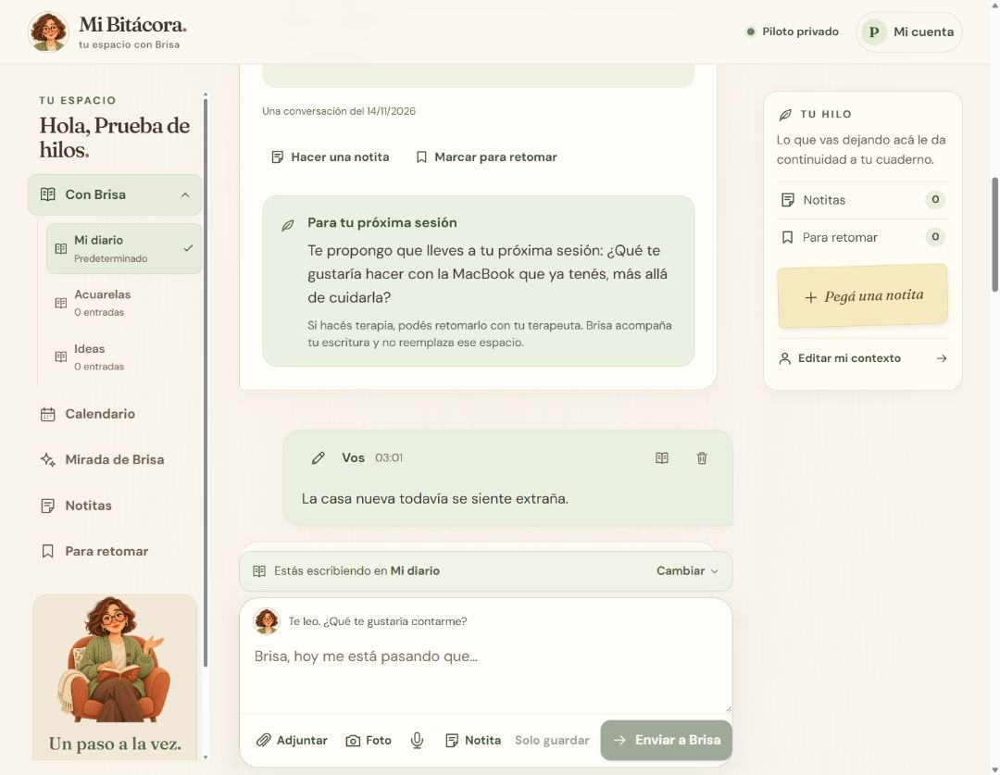

# Diarios dentro de Conversación

**Con Brisa** es un menú desplegable en la navegación fija. Sus submenús muestran todos los diarios de la cuenta: **Mi diario**, marcado como **Predeterminado**, aparece primero; siguen los diarios creados por nombre. El diario abierto queda señalado y los borradores pendientes se indican junto al nombre. Se puede cambiar de diario aunque las tarjetas del encabezado hayan quedado fuera de la pantalla al hacer scroll.

En escritorio, la lista se despliega debajo de **Con Brisa**, con desplazamiento propio cuando hay muchos diarios. En el teléfono, se abre un panel debajo de la barra fija. Elegir un diario cierra el menú y abre su conversación; también permite volver desde Calendario, Notitas o las otras secciones. **Escape** cierra el submenú y devuelve el foco a **Con Brisa**. La selección respeta los bloqueos mientras se envía, se prepara un adjunto o se graba audio.

**Organizar mis diarios** y el selector junto al editor permiten crear, buscar y renombrar diarios. No hay un cupo de cantidad. El menú se actualiza al crear, renombrar o quitar un diario, sin recargar la página.

Las entradas existentes e importadas quedan en **Mi diario**, el diario inicial permanente de cada cuenta. No se clasifican automáticamente. El botón de libro de cada entrada permite moverla a otro diario, junto con sus adjuntos, respuesta y marca para terapia. Mantiene su identificador y fecha originales, así que los enlaces desde el informe siguen funcionando.

Cada diario puede tener varios [hilos conversacionales](hilos-conversacionales.md) a partir de las preguntas de Brisa. Si la entrada forma parte de uno, moverla traslada el hilo completo con sus ramas y adjuntos, para conservar la conversación en un mismo diario.

**Quitar diario** pide confirmación y pasa sus entradas a Mi diario. No elimina mensajes ni archivos. El diario inicial no se renombra ni se quita. Los nombres propios admiten hasta 80 caracteres y deben distinguirse de los demás diarios de esa cuenta, sin diferencias sólo de mayúsculas o espacios.

Cada diario conserva su borrador y los adjuntos todavía sin enviar mientras se cambia de conversación en la misma pestaña. Son borradores en memoria de la sesión, no un guardado automático: recargar o cerrar la página puede perderlos. Si se quita un diario con un borrador, se conserva en Mi diario; si ya había otro allí, se reúnen ambos para que el usuario pueda revisarlos antes de enviar. Siguen vigentes los límites por entrada.

La URL `/bitacora?diario=<id>` vuelve al diario seleccionado al recargar. Se valida que pertenezca a la cuenta autenticada. Un diario inexistente o ajeno abre Mi diario con un aviso, sin revelar datos de otra cuenta.

## Continuidad y memoria

Los turnos recientes y las preguntas anteriores de la IA proceden del **hilo elegido dentro del mismo diario** que el mensaje actual. Fuera de un hilo se usan las entradas del diario sin destinatario explícito. El nombre del diario se envía como etiqueta de organización, no como instrucción. La recuperación semántica sigue recorriendo los textos originales de **todos los diarios de esa cuenta**, incluso antecedentes antiguos. La IA sólo debe relacionarlos cuando sean pertinentes.

El corpus, sus identificadores de fuentes y sus huellas no dependen de la organización en diarios. Mover una entrada o renombrar un diario no reindexa textos intactos ni invalida el informe para terapia. No genera llamadas a la IA. El calendario, la racha, las notitas, el contexto del perfil, Para retomar, el informe y la exportación de datos continúan siendo del cuaderno completo.

## Datos y despliegue

`20261110041051_AddJournalNotebooks` agrega `JournalNotebooks` y `JournalEntries.NotebookId` nullable. `null` representa Mi diario: los registros previos y el importador conservan sus valores, sin reescritura de textos, respuestas o archivos. La clave foránea compuesta por cuenta y diario impide asociaciones entre usuarios también en SQLite. La eliminación de un diario mueve sus entradas en una transacción; el borrado de cuenta incluye los diarios.

Antes de publicar, respaldar SQLite de forma consistente con su API de backup o con la aplicación detenida y todos sus archivos auxiliares. El arranque aplica la migración. No reemplazar App_Data, uploads ni la configuración privada con los de desarrollo. El índice por cuenta, diario y fecha sostiene la paginación independiente; `GetEntriesAsync` sigue devolviendo la vista global para exportaciones y herramientas existentes.

## Verificación

`NotebookChecks` prueba migración desde la versión anterior, conservación de respuestas, nombres, paginación entre hilos intercalados, aislamiento en el servicio y en la clave foránea, memoria entre diarios, informe global, reutilización del índice, movimiento, retirada de diarios y borrado de cuenta. Todas las pruebas usan bases temporales y respuestas simuladas, sin consumir API. La revisión visual usa una cuenta ficticia y comprueba creación, cambio, borradores, renombrado, búsqueda, movimiento, recarga y tamaños móviles. Para el menú fijo se verifica el orden con Mi diario primero, la selección después del scroll, la aparición inmediata de un diario nuevo, el regreso desde Calendario, Escape y el panel móvil de 390 px.
