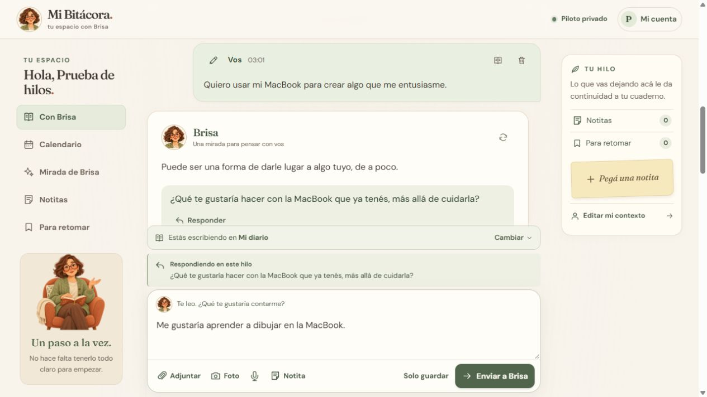

# Responder y retomar hilos con Brisa

**Responder**, junto a la pregunta de una devolución, abre una conversación dentro de ese diario y lleva al editor. El recuadro **Respondiendo en este hilo** muestra el mensaje elegido. Se puede responder también a una devolución sin pregunta y desde la entrada completa.



**Enviar a Brisa** guarda la respuesta enlazada y pide una devolución. **Solo guardar** conserva el mismo vínculo, sin generar ni transcribir. Si falla la IA, el mensaje sigue guardado y se puede reintentar desde su tarjeta. Se mantienen los adjuntos, la grabación de audio, la edición y las marcas para retomar.

**Tus hilos** lista las conversaciones con respuestas, ordenadas por su última actividad, con su pregunta inicial y la cantidad de respuestas. Se puede volver a cualquier hilo, incluso después de recargar la página, o tocar **Volver a todas las entradas** para escribir en el diario general. La vista general conserva todas las entradas en orden cronológico y permite abrir el hilo desde sus respuestas.

El editor continúa desde el último mensaje del hilo. Tocar **Responder** en una devolución anterior cambia el destinatario a ese mensaje: permite explorar otra rama. Cada tarjeta cita la pregunta a la que respondió y enlaza su mensaje anterior. Los borradores de texto y archivos se conservan por diario e hilo mientras la página siga abierta; no se guardan entre recargas.

## Contexto y conservación

`JournalEntry` guarda `ReplyToEntryId` y una copia de la pregunta en `ReplyToQuestion`. La copia se toma de la devolución guardada, no de texto aportado por el cliente. Regenerar esa devolución no cambia la pregunta de las respuestas ya guardadas.

El contexto conversacional de una respuesta sigue hasta ocho ancestros de su rama. La selección posterior conserva hasta seis para OpenAI o dos para Ollama, con la pregunta respondida explícita en el prompt y en la consulta de memoria. Otras ramas y otros hilos no se usan como turnos recientes. El diario general usa sus entradas sin destinatario explícito. La memoria puede recuperar originales pertinentes de cualquier diario de la misma cuenta, y el informe, el calendario, la racha y la exportación siguen incluyendo todas las entradas. Las preguntas y propuestas de Brisa se identifican como voz de la IA.

Mover cualquier mensaje a otro diario mueve su conversación completa, incluidas todas sus ramas, devoluciones y adjuntos. Quitar un diario conserva los vínculos al pasar sus mensajes a Mi diario. Eliminar un mensaje elimina sólo esa entrada y sus archivos; sus respuestas directas pierden el vínculo y la pregunta citada, y pueden iniciar sus propios hilos. Sus descendientes y los otros hilos permanecen guardados.

La migración `AddConversationThreads` agrega columnas opcionales e índice sin reconstruir `JournalEntries`, para conservar los triggers de memoria vectorial existentes. Triggers adicionales verifican que el mensaje anterior pertenezca a la misma cuenta y diario y sea anterior en el tiempo, impiden ciclos y desvinculan las respuestas al borrar un mensaje. Las entradas anteriores y las importaciones sin estos campos mantienen su comportamiento.

## Verificación

`ThreadChecks` usa SQLite temporal y proveedores simulados. Cubre migración de datos anteriores, aislamiento entre cuentas y diarios tanto en el servicio como en SQLite, copia de la pregunta, contexto de ramas, prompts de ambos proveedores, paginación, exportación, movimiento completo, eliminación sin perder respuestas posteriores y borrado de cuenta.

La revisión en navegador usó una cuenta ficticia y un proveedor HTTP local simulado: respuesta desde la pregunta y desde una entrada completa, envío, Solo guardar y pedido posterior de devolución, cambio de hilo, borradores independientes, recarga y ancho móvil de 390 px. La imagen de esta guía muestra esa cuenta de prueba.

```powershell
dotnet build tests/MiBitacora.Checks -p:UseAppHost=false
dotnet tests/MiBitacora.Checks/bin/Debug/net10.0/MiBitacora.Checks.dll
node --test tests/journal-scroll.test.mjs tests/voice-recorder.test.mjs tests/brisa-motion.test.mjs
```
