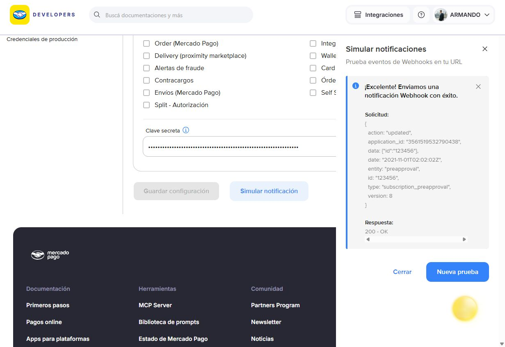
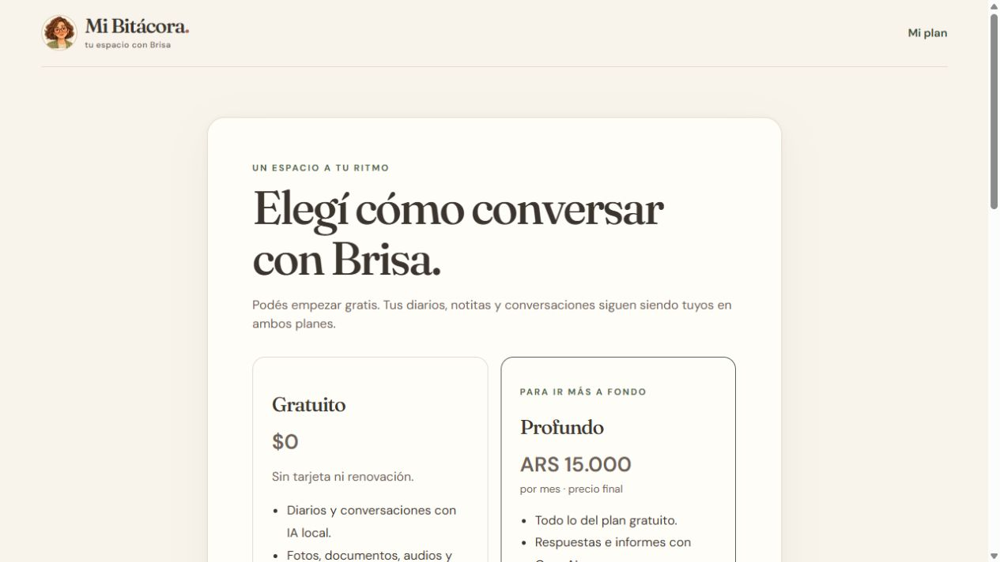

# Lanzar Profundo con Mercado Pago

El código ofrece Profundo a **ARS 15.000 finales por mes**, con 200 créditos por período. El repositorio conserva los cobros deshabilitados por defecto. La configuración privada de cada instalación es independiente; el estado verificado del despliegue y las validaciones externas pendientes se registran al final de esta guía. La configuración y el simulador no demuestran un ciclo de cobros recurrentes completo.

## Lo que debe hacer Armando en Mercado Pago

1. Ingresar con la cuenta argentina que cobrará por COGNITIVA y completar identidad, datos fiscales y habilitación comercial que solicite Mercado Pago.
2. Abrir [Tus integraciones](https://www.mercadopago.com.ar/developers/panel/app), crear o seleccionar la aplicación de Mi Bitácora y elegir **Suscripciones**. El formulario actual exige un nombre sin tildes: `Mi Bitacora`. En su configuración, completar la descripción, la categoría **Servicio de informática** y el sitio `https://mibitacora.ar`. No hace falta crear un plan de suscripción compartido de $15.000: el backend crea cada suscripción individual con ese importe y frecuencia mensual.
3. Obtener el **Access Token de producción** de esa aplicación y el **ID del usuario vendedor / collector**. Guardarlos solo en la configuración privada del servidor, con acceso del administrador y de la identidad de IIS. No enviarlos por chat ni guardarlos en Git. El token debe permitir gestionar las suscripciones, consultar pagos y devolverlos. El control `--check-merchant` comprueba que pertenece al collector configurado y al sitio argentino `MLA` mediante una consulta de lectura.
4. Abrir **Webhooks → Configurar notificaciones → Modo productivo**. URL receptora: `https://mibitacora.ar/api/mercadopago/webhook`. Marcar **Planes y suscripciones** y **Pagos (legacy)**. Guardar genera la **Clave secreta**, que se conserva como `Subscriptions:WebhookSecret` en el servidor. Tipos que procesa el código: `payment`, `subscription_preapproval`, `subscription_authorized_payment`. Comprobar la entrega firmada con el simulador del panel y después con un evento real de la integración.
5. Preparar una prueba con cuentas/medios de prueba admitidos por Suscripciones, separados del vendedor. Después de comprobar el entorno de prueba, realizar una prueba productiva controlada con un comprador autorizado, verificando el importe final, primer cargo, baja y reintegro. No usar el propio vendedor como comprador ni asumir que el simulador local prueba MP.

**Modalidad verificada en el panel el 17/11/2026:** las aplicaciones de Suscripciones permiten configurar esos eventos y generar la firma desde Webhooks. Se usa esa configuración de aplicación; la creación de la preaprobación envía únicamente sus campos documentados, sin `notification_url`. La [guía de notificaciones](https://www.mercadopago.com.ar/developers/es/docs/subscriptions/additional-content/your-integrations/notifications/webhooks) conserva una advertencia que no coincide con esta interfaz, por lo que hay que comprobar la entrega efectiva. Si la modalidad disponible en otra cuenta no ofrece firma, no inventarla ni aceptar webhooks sin verificar: dejar `WebhookSecret` vacío deshabilita el endpoint y mantiene la conciliación por API. La falta de notificación nunca habilita acceso sin pago.

Las [suscripciones pendientes sin plan asociado](https://www.mercadopago.com.ar/developers/es/docs/subscriptions/integration-configuration/subscription-no-associated-plan/pending-payments) usan el checkout alojado de Mercado Pago. Los reintegros emplean [Refunds API](https://www.mercadopago.com.ar/developers/en/reference/online-payments/checkout-api-payments/create-refund/post) con clave de idempotencia y verificación posterior del pago.

## Configuración privada

Combinar estas secciones en `App_Data/ai.settings.json`, conservando OpenAI, Ollama y el puente de inferencia existentes. Alternativamente usar variables de entorno con doble guion bajo. No reemplazar el archivo completo ni copiar valores reales a un ejemplo versionado. Los siguientes valores entre `<...>` son marcadores, no credenciales válidas:

```json
{
  "AI": { "OpenAiForAllAccounts": false },
  "Subscriptions": {
    "Provider": "MercadoPago",
    "AllowLiveRequests": true,
    "AcceptNewSubscriptions": false,
    "LaunchUserIds": ["<ID de la cuenta de lanzamiento>"],
    "AccessToken": "<ACCESS TOKEN PRIVADO>",
    "CollectorId": "<ID NUMERICO DEL VENDEDOR>",
    "WebhookSecret": "",
    "PublicBaseUrl": "https://mibitacora.ar",
    "MonthlyPriceArs": 15000,
    "MonthlyCredits": 200,
    "ReportCredits": 10,
    "WithdrawalDays": 10,
    "ReconcileMinutes": 1
  },
  "Mail": {
    "Delivery": "Smtp",
    "Host": "<SERVIDOR SMTP>",
    "Port": 587,
    "EnableSsl": true,
    "Username": "<USUARIO SMTP>",
    "Password": "<CLAVE SMTP>",
    "From": "<REMITENTE AUTORIZADO POR ESE SMTP>"
  },
  "Administration": { "UserIds": ["<ID de la cuenta administradora>"] }
}
```

El envío usa MailKit con TLS obligatorio y validación normal del certificado: puerto **465** con TLS desde el inicio de la conexión, o STARTTLS para los demás puertos (habitualmente **587**), sin volver a texto plano si no está disponible. El correo comercial y de atención es **contacto@cognitiva.ar**. Configurar el remitente autorizado y SPF/DKIM/DMARC según el proveedor. Verificar entrega efectiva de recuperación, confirmación y constancia comercial en una casilla externa y en correo no deseado.

`AcceptNewSubscriptions=false` permite preparar la instalación manteniendo la gestión de clientes existentes. Para probar checkout productivo, ponerlo en `true` **con `LaunchUserIds` limitado a los usuarios de prueba autorizados**. El servidor aplica esa lista, incluso ante un POST manipulado. Cuando se complete la aceptación, vaciar la lista y mantener `true` para abrir al público. Reiniciar IIS después de cada cambio.

## Comprobación previa sin modificar datos

Desde la carpeta publicada, bajo la misma identidad/configuración de producción:

```powershell
dotnet MiBitacora.dll --check-billing
dotnet MiBitacora.dll --check-merchant
dotnet MiBitacora.dll --check-mail
```

El primer comando no abre SQLite ni llama servicios externos. El segundo agrega solamente `GET https://api.mercadopago.com/users/me`; no crea ni cancela suscripciones. El tercero verifica TLS y autenticación SMTP sin enviar un correo. Pueden combinarse los indicadores. No imprimen claves ni datos del diario. Salida 2 indica configuración pendiente. Estos controles no verifican por sí mismos la entrega de correo, modelos, checkout, notificaciones, renovación ni reintegros.

## Publicación y aceptación

1. Compilar Release y ejecutar la suite. Crear respaldo consistente de SQLite con la app detenida (o API de backup), uploads y claves de Data Protection. Conservar configuración privada y códecs. `dotnet publish -c Release -o <carpeta de staging>` no debe incluir App_Data, uploads ni credenciales.
2. Publicar con IIS detenido o `app_offline.htm`, preservando `App_Data`, `uploads`, `media-tools` y sus ACL. La migración `LaunchRecurringSubscriptions` agrega consumo, solicitudes, correos, auditoría y campos de aceptación. `PreserveBillingAfterAccountDeletion` reconstruye únicamente la tabla comercial para separar su conservación del borrado de cuenta. No reconstruye las tablas de entradas ni sus índices FTS. No volver a un binario anterior sobre una base nueva sin restaurar el respaldo completo.
3. Configurar Application Pool en **AlwaysRunning**, preload y sin suspensión por inactividad, según la versión instalada de IIS/Application Initialization. Mantener una sola aplicación escritora y respaldos probados. Los trabajadores de conciliación y correo viven dentro de la web: si está detenida, no procesan pendientes. Monitorizar el sitio, los logs y `/admin/suscripciones`; los errores no deben quedarse pendientes sin atención.
4. Verificar HTTPS, correo transaccional, inicio/cierre de sesión, recuperación y confirmación. Las claves estables en `App_Data/data-protection` deben sobrevivir despliegues, y la cuenta de IIS debe poder abrirlas con DPAPI. El primer cambio del nombre de aplicación puede cerrar sesiones anteriores.
5. Mantener datos ficticios separados de producción. Verificar la IA local del plan gratuito y una respuesta/informe de OpenAI con cuenta autorizada y saldo. Revisar también agotamiento y cambio a IA local. Configurar el presupuesto/alertas del proyecto OpenAI.
6. Con ventas limitadas por `LaunchUserIds`, aceptar expresamente ARS 15.000 mensuales, completar el checkout y comprobar que la autorización sola no activa el plan, el primer pago aprobado sí, y su período/constancia coinciden. Doble clic y regreso del checkout no deben generar otra suscripción.
7. Verificar el rechazo/reintento, la conciliación sin webhook, entrega firmada si está disponible, cancelación normal, pedido público sin sesión y reintegro al medio original. Confirmar ausencia de nuevas renovaciones después de la baja. Verificar que un cargo tardío se devuelve y que los avisos llegan. Validar una renovación real/controlada antes de afirmar que el ciclo completo de recurrencia fue probado; no simularlo modificando fechas de pagos productivos.
8. Revisar con el titular los datos, condiciones y política publicados. Sostener atención de lunes a viernes 9–17. Preparar con el contador el punto de venta, emisión y entrega de **factura C** y notas de crédito, y el plazo de conservación fiscal. Registrar el número emitido en el panel. La constancia del sitio no sustituye esa emisión ni se debe esperar a que el cliente la pida.
9. Registrar fecha, IDs de operación y resultado de la aceptación sin secretos. Vaciar `LaunchUserIds` para abrir ventas cuando corresponda. Para detener nuevas altas usar `AcceptNewSubscriptions=false`; conservar `Provider=MercadoPago` y `AllowLiveRequests=true` mientras existan obligaciones de conciliación, baja o reintegro.

## Operación diaria

Revisar pagos, movimientos de caja reales de MP (comisiones incluidas), solicitudes pendientes, colas con varios intentos, conciliaciones demoradas, facturas C y notas de crédito. El panel informa movimientos según fecha de conciliación y MRR contratado, no reemplaza el extracto de MP ni la contabilidad. Un reintegro parcial o una disputa compleja iniciada fuera del sitio se revisa en MP y soporte; la conciliación conserva el importe reintegrado y los estados finales. Conservar evidencia comercial mínima separada del diario, y limitar acceso y retención de correos/tokens, soporte y respaldos. Verificar restauraciones periódicamente.

La recepción sin registro, constancia y verificación razonable de identidad se implementó tomando como referencia la [Disposición 954/2025](https://www.argentina.gob.ar/normativa/nacional/norma-417152/texto), su [aclaración 3/2026](https://www.boletinoficial.gov.ar/detalleAviso/primera/338248/20260206) y la [Ley 24.240](https://www.argentina.gob.ar/normativa/nacional/638/actualizacion). La emisión fiscal se apoya en la [guía oficial de comprobantes para monotributistas de ARCA](https://www.arca.gob.ar/facturacion/monotributo/comprobantes.asp). La garantía comercial de diez días sobre el último cargo es voluntariamente favorable y no sustituye otros derechos aplicables. El titular debe revisar estos textos y la operación fiscal antes de abrir ventas.

## Registro de puesta en marcha: 17/11/2026

Se publicó y verificó el código `dd25d4c` en `https://mibitacora.ar`, con respaldo consistente de SQLite, adjuntos, configuración y código anterior. La verificación confirmó 425 archivos publicados, las migraciones comerciales aplicadas, las 21 tablas originales sin cambios en sus datos previos y los 297 adjuntos conservados. El cuaderno anónimo continúa redirigiendo al inicio de sesión. Las seis páginas públicas comerciales y de atención responden 200 y muestran `contacto@cognitiva.ar`.

La aplicación **Mi Bitacora** de Suscripciones tiene credenciales productivas activadas y Webhooks de **Planes y suscripciones** y **Pagos (legacy)** guardados. Las claves se guardaron en la configuración privada, fuera de Git y del contenido público. `--check-merchant` confirmó que el token corresponde al vendedor argentino configurado. El servidor funciona con `Provider=MercadoPago` y `AllowLiveRequests=true`. Se mantuvo `AcceptNewSubscriptions=false` durante la configuración; después el titular autorizó la prueba real limitada que se detalla más abajo. Hasta preparar su formulario no se creó ninguna suscripción ni se realizó un cobro.

El remitente y contacto comercial es `contacto@cognitiva.ar`, por SMTP con TLS implícito en puerto 465. `--check-mail` comprobó el certificado, la conexión cifrada y la autenticación. Después se envió, con autorización del titular, una confirmación desde el formulario público: SMTP la aceptó sin reintentos, el cuerpo con su token se eliminó de la cola y el titular confirmó su recepción y abrió el enlace con éxito. La base confirmó `EmailConfirmed=true`. El DNS consultado publica SPF y DMARC; no se verificó DKIM. Un primer intento del formulario devolvió 520 sin crear correo; se verificó el envío tras reiniciar la aplicación. El diagnóstico temporal se retiró y `web.config` se restauró byte por byte; el sitio volvió a responder 200.

Una prueba propia sobre la URL pública recibió 200 con firma válida y su repetición dejó un solo registro durable. Solicitudes sin firma o con identificador distinto devolvieron 400 y no se agregaron a la bandeja. También se completó el simulador **del panel de Mercado Pago**, en producción, con **Planes y suscripciones** y el Data ID de ejemplo `123456`: entregó `type=subscription_preapproval` y mostró **200 - OK**. Se comprobó un registro durable de ese recurso en la bandeja del servidor. Un intento anterior con un ID alfanumérico mostró 403 y solicitud vacía en el simulador; el intento con el ejemplo numérico funcionó sin modificar la configuración ni relajar la firma. El recurso ficticio no habilita Profundo y se descarta tras los reintentos previstos para recursos sin contratación local. No es evidencia de un pago aprobado.



Se identificó por correo exacto la cuenta existente del titular y se habilitó su acceso a `/admin/suscripciones` mediante la configuración privada, conservando los demás ajustes. No se creó otra cuenta ni se modificó su contraseña; la confirmación del correo se hizo por el flujo normal. Se verificó el inicio de sesión y la apertura real del panel: cero suscripciones, cero movimientos de cobros, ventas deshabilitadas y cero correos pendientes. Tras reiniciar la aplicación, el sitio respondió 200 y `--check-billing` terminó con salida 0, incluidas la configuración administrativa y la pausa de nuevas contrataciones.

Las validaciones externas pendientes son checkout, primer pago, baja y reintegro con comprador autorizado; los demás correos del ciclo comercial; y la operación de emisión fiscal y atención de solicitudes. Una renovación real aún no fue observada. Para pruebas productivas restringidas se usa `LaunchUserIds`, con comprador de Mercado Pago distinto del vendedor y confirmación humana del pago. Las pruebas locales (462 comprobaciones .NET y 21 de JavaScript) no sustituyen estas verificaciones externas.

**Prueba real limitada autorizada:** se configuró `AcceptNewSubscriptions=true` con `LaunchUserIds` conteniendo **exclusivamente la cuenta confirmada del titular**, a ARS 15.000 mensuales y 200 créditos. Las otras cuentas siguen excluidas de la contratación. Se respaldó consistentemente la base y se retiró solo la concesión de cortesía del titular, que impedía contratar y verificar la activación por pago. La herramienta administrativa se ejecutó con su ID explícito; las otras 24 tablas conservaron sus datos y la integridad SQLite y sus claves foráneas se verificaron antes de reabrir el sitio. Se conserva el respaldo privado con la concesión original para restaurarla al concluir una prueba cancelada/reintegrada; la restauración debe limitarse a ese registro y conservar cualquier actividad posterior.

La sesión del titular mostró el plan Gratuito y el formulario real de Profundo, con correo del comprador, aceptación explícita, ARS 15.000 por mes y 200 créditos. `--check-billing` terminó con salida 0 y confirmó la restricción de contratación por cuentas. Se dejó el formulario al titular para que revise y acepte las condiciones y autorice personalmente el pago en Mercado Pago; esas acciones no se ejecutaron automáticamente. La prueba aún no demuestra un primer pago ni una renovación aprobados.

**Decisión de publicación:** el titular indicó que no dispone de un comprador para esa prueba y pidió publicar para compartir el sitio con amigos. Autorizó continuar con la contratación pública al precio acordado, dejando documentada la falta de un primer pago real. La publicación debe quitar la restricción `LaunchUserIds`, conservar el precio y el cupo y restaurar exactamente su concesión de cortesía desde el respaldo de la prueba. No se debe crear una suscripción ni aceptar condiciones por el titular. Se volvieron a ejecutar las 462 comprobaciones .NET y las 21 de JavaScript, todas satisfactorias, y la compilación Release no emitió advertencias ni errores. Las consultas de lectura `/preapproval/search` y `/v1/payments/search` respondieron 200 con el token configurado. También se aclaró en Mi plan que cada cobro lleva su factura C; no se condiciona su emisión a que el cliente la solicite.

**Publicación completada y verificada el 17/11/2026 a las 11:58 de Argentina:** código `9c3deb6`, 425 archivos de aplicación verificados y dos actualizados. Se respaldaron la base, los 297 adjuntos, la configuración y las claves de Data Protection. La concesión original del titular se restauró campo por campo; las otras 24 tablas conservaron sus datos y pasaron integridad y claves foráneas. Se preservaron adjuntos, claves y códecs. Las ventas públicas quedaron habilitadas con `AcceptNewSubscriptions=true`, `LaunchUserIds=[]`, precio mensual ARS 15.000 y 200 créditos.

Se comprobaron HTTP 200 en inicio, planes, registro, condiciones, privacidad, baja, arrepentimiento y soporte; el diario anónimo redirige al ingreso. `--check-billing` terminó con salida 0 y sin restricción de cuentas. La sesión del titular volvió a mostrar Profundo de cortesía y la página pública mostró los planes y precios correctos. No se ejecutó ninguna contratación ni cobro durante esta publicación. La primera compra real y las validaciones de renovación, cancelación y reintegro siguen pendientes; la apertura pública fue una decisión explícita del titular con ese alcance. La emisión de factura C continúa a cargo del titular en su sistema fiscal y se registra en el panel.


